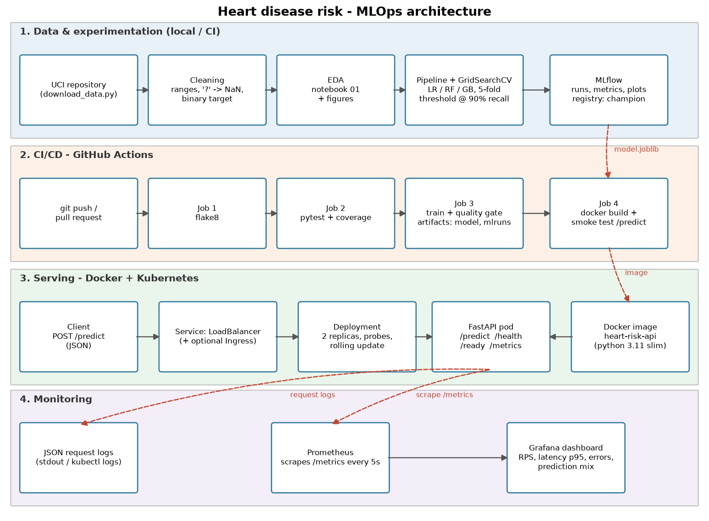

# Heart Disease Risk - End-to-End MLOps Pipeline

BITS Pilani WILP - Machine Learning Operations (AIMLCZG523), Assignment 1
Abishek J S (2025AE05545)

A classifier that predicts heart disease risk from 13 clinical attributes (UCI Heart
Disease, Cleveland). The project covers the full path from raw data to a monitored API:
EDA, a tuned and tracked model (MLflow), a reproducible package, CI/CD (GitHub Actions),
a Docker image, a Kubernetes deployment, and Prometheus + Grafana monitoring.



## Results

| Model | CV ROC-AUC | CV recall @0.5 | Test ROC-AUC | Test recall @ tuned threshold | Threshold |
|---|---|---|---|---|---|
| **Logistic Regression (champion)** | **0.907** | 0.801 | **0.961** | **0.964** | 0.30 |
| Random Forest | 0.900 | 0.764 | 0.954 | 0.964 | 0.31 |
| Gradient Boosting | 0.884 | 0.765 | 0.958 | 0.964 | 0.22 |

The champion is chosen on 5-fold CV ROC-AUC only. The decision threshold is the highest
cut-off that reaches 90% recall on out-of-fold training predictions, because missing a sick
patient costs more than a false alarm. The 20% hold-out set is used only for the final numbers.

## Repository layout

```
src/heartrisk/         config, data, features, train, predict, api, eda
scripts/               download_data, run_eda, load_test, draw_architecture, build_report
notebooks/             01_eda, 02_training, 03_inference (executed, with outputs)
data/raw, processed/   raw UCI file + cleaned CSV
models/                model.joblib (preprocessing + model) + model_meta.json
tests/                 pytest suite - data, features, model, api, eda
.github/workflows/     ci.yml - lint -> test -> train -> docker smoke test
Dockerfile, docker-compose.yml, k8s/, monitoring/
screenshots/           evidence for the report
reports/               figures, model comparison, final report (.docx)
```

## 1. Setup (clean machine)

Python 3.11 is recommended (it matches the Docker image).

```bash
git clone https://github.com/<your-github-username>/heart-disease-mlops.git
cd heart-disease-mlops
python3.11 -m venv .venv
source .venv/bin/activate            # Windows: .venv\Scripts\activate
pip install -r requirements.txt      # installs pinned libs + this package (-e .)
```

## 2. Data, EDA, training

```bash
python scripts/download_data.py      # UCI -> data/raw, cleaned -> data/processed
python scripts/run_eda.py            # figures -> reports/figures
python -m heartrisk.train            # grid search x3 models, MLflow, saves models/
mlflow ui --backend-store-uri sqlite:///mlflow.db --port 5000   # http://localhost:5000
```

The same steps, with commentary, are in `notebooks/01_eda.ipynb`, `02_training.ipynb` and
`03_inference.ipynb`.

## 3. Tests and lint

```bash
flake8 src tests scripts
pytest -v --cov=heartrisk
```

## 4. Run the API

```bash
uvicorn heartrisk.api:app --port 8000          # without Docker
# or
docker build -t heart-risk-api:1.0.0 .
docker run --rm -p 8000:8000 heart-risk-api:1.0.0

curl -X POST localhost:8000/predict -H 'Content-Type: application/json' -d @samples/high_risk.json
```

Response:

```json
{"prediction": 1, "label": "heart disease risk", "probability_disease": 0.9932,
 "confidence": 0.9932, "risk_band": "high", "threshold": 0.3, "model_version": "1.0.0+..."}
```

Endpoints: `POST /predict`, `POST /predict/batch`, `GET /health`, `GET /ready`,
`GET /model-info`, `GET /metrics`, `GET /docs`.

## 5. Kubernetes (Docker Desktop or Minikube)

```bash
docker build -t heart-risk-api:1.0.0 .
kubectl apply -f k8s/namespace.yaml
kubectl apply -f k8s/deployment.yaml -f k8s/service.yaml
kubectl -n heart-risk rollout status deployment/heart-api
kubectl -n heart-risk get pods,svc
curl -X POST http://localhost/predict -H 'Content-Type: application/json' -d @samples/high_risk.json
```

On Minikube, first run `eval $(minikube docker-env)` before `docker build`, then run
`minikube tunnel` in a second terminal so the LoadBalancer gets an IP.

## 6. Monitoring

```bash
docker compose up -d --build                  # API :8000, Prometheus :9090, Grafana :3000
python scripts/load_test.py --n 300           # generates traffic
```

Grafana: http://localhost:3000 (admin / admin) -> Dashboards -> Heart Risk -> Heart Risk API.

## 7. CI/CD

`.github/workflows/ci.yml` runs on every push and pull request to `main`:

1. **Lint** - flake8
2. **Unit tests** - data download, quick training, pytest with coverage (junit + coverage artifacts)
3. **Train** - full training, quality gate, uploads model, MLflow runs and reports
4. **Docker** - builds the image, starts it, checks `/ready`, `/predict`, a 422 for bad input, and `/metrics`

Any failure stops the pipeline at that job, and the failing step's log is shown.

## 8. Report

```bash
python scripts/build_report.py     # -> reports/MLOps_Assignment1_Report.docx
```

The script reads metrics, figures and the `screenshots/` folder. Edit
`reports/report_config.json` (repo link, video link) before the final build.
